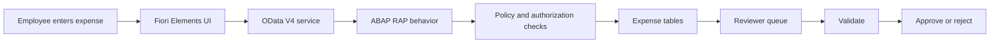

# project live url- https://a4796127-12c7-4a21-ae82-e3ced4ab9c3d.abap-web.us10.hana.ondemand.com/sap/bc/ui5_ui5/sap/zind10_exp_ui/index.html?sap-client=100&sap-ui-language=EN&v=1.2.0-release


# Smart Expense Claim Validator

An expense-review application built with **SAP BTP ABAP Environment, ABAP RAP, CDS, OData V4, and SAP Fiori Elements**.

Employees submit expense claims. The ABAP backend checks receipts, dates, duplicate submissions, and category limits. Assigned reviewers validate claims and approve or reject them.


## How it works

1. A provisioned SAP user signs in and creates an expense claim.
2. RAP saves the draft and checks the claim when it is saved.
3. Valid claims become **READY**; claims with policy issues become **FLAGGED** with an explanation.
4. An assigned reviewer opens another claimant's saved expense and selects **Validate**, **Approve**, or **Reject**.
5. Approval checks the policy again. Approved claims are locked against further edits and review.
6. The owner can correct and resubmit a rejected claim.

**READY means the policy checks passed; it does not mean approved.**



## Features

- Draft-enabled claim creation and editing.
- Required-field, receipt, date, amount, currency, and category checks.
- Duplicate checks scoped to the claimant.
- Backend role and ownership checks, including a prohibition on self-review.
- Owners see their claims; assigned reviewers see the review queue through CDS access control.
- Fixed responsive header, clickable project logo, and SAP logout link.
- Clear filter values with the **Clear** button, then select **Go** to refresh results.
- Simplified filters hide the technical Editing Status selector and Adapt Filters button while preserving RAP draft handling.
- ABAP Unit tests for policy and authorization decisions.

## Example policy

| Category | Maximum per claim |
|---|---:|
| Meals | INR 1,000 |
| Travel | INR 5,000 |
| Hotel | INR 8,000 |
| Office | INR 2,000 |

Amounts must be positive, currency must be INR, dates cannot be in the future, and expenses cannot be older than 90 days. A receipt reference and merchant are required. These are illustrative project rules.

## Repository layout

| Path | Contents |
|---|---|
| `src/` | ABAP classes, tests, database definitions, CDS views, RAP behavior, service and IAM snapshots |
| `fiori-ui/webapp/` | Editable Fiori Elements application |
| `fiori-ui/package.json` | UI build command and dependency |
| `docs/SETUP.md` | Setup sequence, object dependencies, and access configuration |
| `docs/VERIFICATION.md` | Recorded verification and practical limits |
| `docs/demo-scenarios.json` | Twenty-two fictional review scenarios |

## Build the UI

From `fiori-ui/`:

```sh
npm install
npm run build
```

Deploy the generated `dist/` content to the target SAP UI5 repository. The UI expects SAP-hosted UI5 resources and an authenticated OData service on the same host. Opening `index.html` directly or hosting it on GitHub Pages will not provide a working SAP backend.

## SAP setup

Follow [the setup guide](docs/SETUP.md). This repository contains **source snapshots, not an abapGit import package**. SAP objects and required access must be created/configured in an ABAP environment.

Personal account identifiers in the public copy are replaced with `CB0000000000` and `reviewer@example.invalid`. These are placeholders, not login credentials. The deployed application was not changed by this publication.

A SAP Universal ID alone does not grant access to an ABAP tenant. Users require provisioning and service authorization in the system hosting this app.

## Demo and verification

On 20 October 2026, the development system was populated with 12 fictional claims: six policy-valid and six with policy issues. The real RAP Validate, Approve, and Reject handlers were exercised under the reviewer identity. Test decisions were rolled back, leaving all 12 claims NEW for manual review at that time.

Version 1.2.0 adds ten more fictional claims, `DEMO-013` through `DEMO-022`: four policy-valid and six with policy issues. The append operation preserved all 13 existing claims and their review decisions, bringing the development system to 23 claims. Validation checks were rolled back, leaving the ten additions NEW for manual review.

The synthetic `DEMO_EMPxx` owners are demo fixture identifiers, not provisioned login accounts. The retained `ZCL_IND10_DEMO_RESET` class is read-only; it cannot delete or reseed claims. The guarded `ZCL_IND10_DEMO_ADD10` class only appends its ten fixtures and refuses to run if any of their claim IDs already exist.

See [verification details](docs/VERIFICATION.md). This is a learning project: it does not include OCR, AI classification, payments, anonymous signup, or production-grade multi-tenant onboarding.
